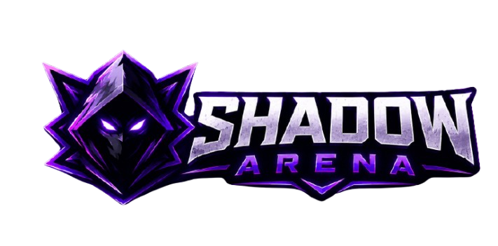

# 🎮 ShadowArena

<div align="center">



### Modern Responsive Esports Gaming Website

A premium cyberpunk-inspired esports website built using **HTML, CSS and JavaScript**.


</div>

---

# 📖 Overview

ShadowArena is a fully responsive esports gaming website designed with a modern cyberpunk UI. The project showcases tournaments, featured games, gaming news, livestreams, team members, sponsors, galleries, and multiple utility pages while maintaining a clean and engaging user experience.

---

# ✨ Features

- 🎮 Modern Gaming UI
- 📱 Fully Responsive Design
- 🏆 Tournament Section
- 🎯 Featured Games
- 📰 Gaming News
- 🎥 Live Streams
- 👥 Team Page
- 🖼 Gallery
- 📞 Contact Page
- ℹ About Page
- ❓ Help Center
- 🔒 Privacy Policy
- 📜 Terms & Conditions
- 🚫 Custom 404 Page
- 🌌 Cyberpunk Theme
- ⚡ Smooth Hover Animations

---

# 📂 Project Structure

```
ShadowArena/
│
├── index.html
├── 404.html
├── favicon.png
├── README.md
├── LICENSE
├── .gitignore
│
├── assets/
│   │
│   ├── css/
│   │   ├── style.css
│   │   ├── about.css
│   │   ├── contact.css
│   │   ├── gallery.css
│   │   ├── help.css
│   │   ├── privacy.css
│   │   ├── team.css
│   │   ├── terms.css
│   │   ├── tournament.css
│   │   └── 404.css
│   │
│   ├── HTML/
│   │   ├── about.html
│   │   ├── contact.html
│   │   ├── gallery.html
│   │   ├── help.html
│   │   ├── privacy.html
│   │   ├── team.html
│   │   ├── terms.html
│   │   └── tournament.html
│   │
│   ├── js/
│   │   └── script.js
│   │
│   └── images/
│       ├── logo.png
│       ├── hero-banner.png
│       ├── hero-banner-bg.png
│       ├── about.png
│       ├── game1.png - game6.png
│       ├── gallery1.png - gallery9.png
│       ├── live1.png - live3.png
│       ├── news1.png - news3.png
│       ├── sponsor images
│       ├── team images
│       ├── tournament images
│       └── other assets
```

---

# 🚀 Technologies Used

- HTML5
- CSS3
- JavaScript
- Google Fonts
- Font Awesome

---

# 📱 Responsive Design

The website is optimized for:

- Desktop
- Laptop
- Tablet
- Mobile

---

# 📸 Pages Included

- Home
- Tournament
- Gallery
- Team
- About
- Contact
- Help Center
- Privacy Policy
- Terms & Conditions
- Custom 404 Page

---

# 🎨 Theme

- Dark Purple Cyberpunk
- Neon Glow Effects
- Esports Inspired Layout
- Modern UI Components

---

# 💻 Installation

Clone the repository:

```bash
git clone https://github.com/yourusername/shadowarena-esports.git
```

Open the project:

```bash
cd shadowarena-esports
```

Launch:

```text
Open index.html in your browser.
```

---

# 📌 Future Improvements

- User Authentication
- Backend Integration
- Tournament Registration
- Live Match API
- Leaderboards
- Admin Dashboard
- Dark/Light Theme Toggle

---

# 👨‍💻 Author

**Samyak Dutta**

Computer Science Student • Front-End Developer

---

# ⭐ Support

If you like this project, consider giving it a ⭐ on GitHub.

---

# 📜 License

This project is licensed under the MIT License.